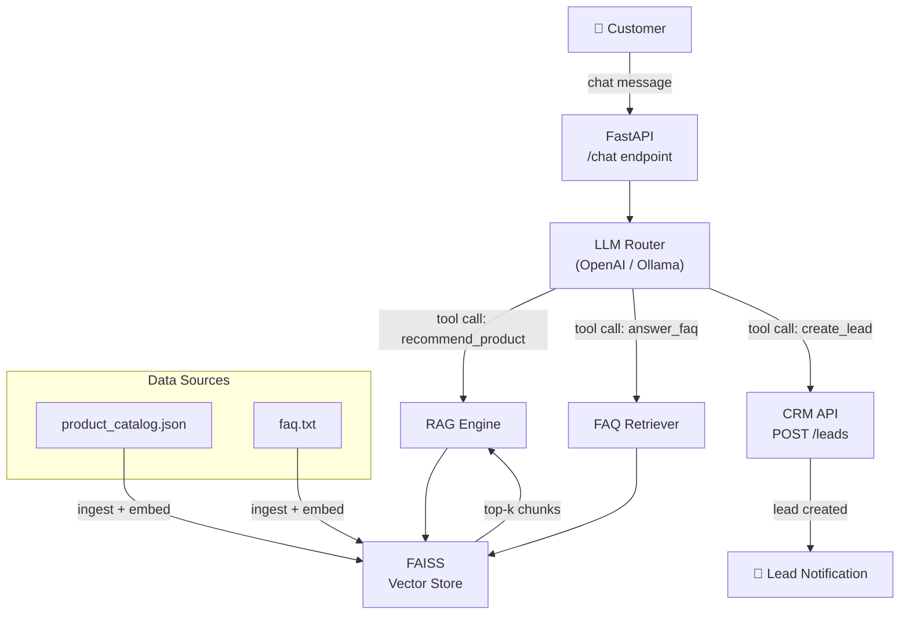

# Sales AI Agent

<p align="center">
  
  
  
  
  
  
</p>

A production-grade **conversational Sales AI Agent** for an online bike shop — built with FastAPI, RAG-powered product recommendations, CRM lead creation, and support for both OpenAI and local LLMs via Ollama.

---

## ✨ What It Does

The agent handles a complete sales workflow end-to-end:

1. **Consults** customers through a multi-turn chat API
2. **Recommends** bikes using RAG over a product catalog (vector search with FAISS)
3. **Answers FAQs** from an unstructured knowledge base
4. **Detects purchase intent** and collects customer details
5. **Creates CRM leads** automatically when interest is confirmed

---

## 🏗️ Architecture



---

## 🚀 Quick Start

```bash
git clone https://github.com/ahmadalsharef994/sales-ai-agent-example.git
cd sales-ai-agent-example

cp .env.example .env
# Set OPENAI_API_KEY or configure Ollama URL

docker-compose up --build
```

API is available at `http://localhost:8000`
Swagger docs at `http://localhost:8000/docs`

### Without Docker

```bash
python -m venv venv && source venv/bin/activate
pip install -r requirements.txt
uvicorn app.main:app --reload
```

---

## 💬 API Usage

### Send a chat message

```bash
curl -X POST http://localhost:8000/chat \
  -H "Content-Type: application/json" \
  -d '{
    "session_id": "user-123",
    "message": "I am looking for a mountain bike under 1500 euros"
  }'
```

**Response:**
```json
{
  "reply": "Great choice! Based on your budget, I recommend the TrailBlazer X3 (€1,299) — full suspension, 29\" wheels, perfect for trail riding. Would you like more details or compare it with other options?",
  "intent": "product_interest",
  "recommended_products": ["TrailBlazer X3", "Summit Pro 29"]
}
```

### Lead is auto-created when intent is confirmed

```bash
curl -X POST http://localhost:8000/chat \
  -d '{"session_id": "user-123", "message": "Yes, I want to buy it. My name is John, email john@example.com"}'
```

```json
{
  "reply": "Perfect! I've registered your details and a sales consultant will reach out shortly.",
  "lead_created": true,
  "lead_id": "lead-abc123"
}
```

---

## 🧠 AI Techniques Used

| Technique | Implementation |
|---|---|
| **RAG** | Product catalog + FAQ chunked, embedded, stored in FAISS |
| **Vector Search** | FAISS cosine similarity for top-k retrieval |
| **Prompt Engineering** | System prompt with role, tone, constraints, and tool definitions |
| **Tool Calling** | LLM decides when to call `recommend_product`, `answer_faq`, `create_lead` |
| **Multi-turn Context** | Conversation history passed in each request |
| **Intent Detection** | Detected from LLM output to trigger lead creation |

---

## ⚙️ Configuration

```env
# LLM Provider (choose one)
OPENAI_API_KEY=sk-...
OLLAMA_URL=http://localhost:11434   # for local LLMs

# CRM
CRM_API_URL=http://your-crm/api/v1
CRM_API_KEY=...

# App
PORT=8000
LOG_LEVEL=info
```

---

## 📁 Project Structure

```
├── app/
│   ├── main.py              # FastAPI app + routes
│   ├── agent.py             # LLM agent logic + tool orchestration
│   ├── rag.py               # RAG pipeline (ingest, embed, retrieve)
│   ├── tools/
│   │   ├── recommend.py     # Product recommendation tool
│   │   ├── faq.py           # FAQ answering tool
│   │   └── lead.py          # CRM lead creation tool
│   └── models.py            # Pydantic schemas
├── data/
│   ├── product_catalog.json
│   └── faq.txt
├── tests/
├── docker-compose.yml
└── requirements.txt
```

---

## 🧪 Testing

```bash
pytest tests/ -v
```

---

## 🤝 Contributing

PRs welcome. Please open an issue first for major changes.

## 📄 License

MIT
